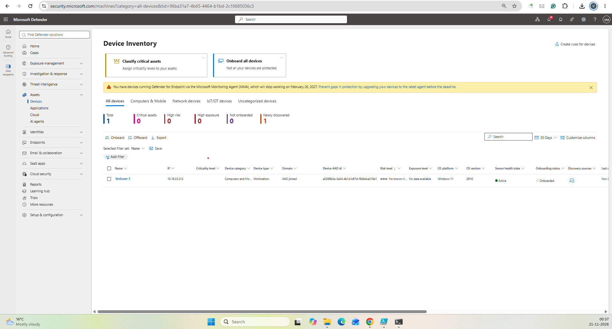
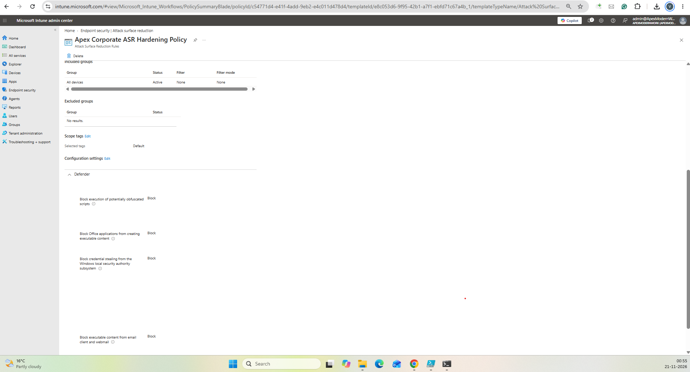
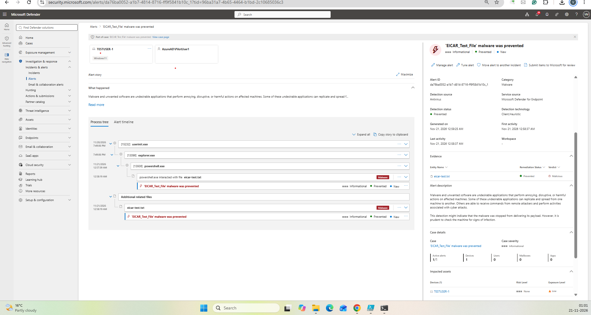
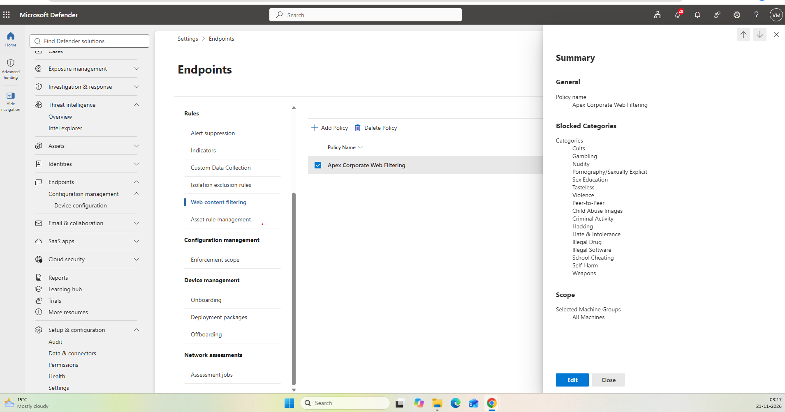

# Enterprise Microsoft Defender for Endpoint (EDR), ASR & Web Filtering Lab (Module 10)

## Overview
This repository documents an end-to-end **Microsoft Defender for Endpoint (EDR)**, **Attack Surface Reduction (ASR)**, and **Web Content Filtering** deployment across Windows 11 endpoints (`TESTUSER-1`) in the `ApexModernWork.onmicrosoft.com` enterprise tenant, managed via **Microsoft Intune** and **Microsoft Defender XDR**.

---

## Architecture & Implemented Controls

### 1. Windows 11 EDR Onboarding & Device Inventory (`01-Endpoint-Onboarding`)
- **Automated Intune EDR Policy:** Deployed the Defender for Endpoint onboarding package via Microsoft Intune to Azure AD-joined Windows 11 devices (`TESTUSER-1`).
- **Sensor & Telemetry Verification:** Confirmed active `MsSense.exe` sensor health, exposure level telemetry, and active device onboarding status inside the Microsoft Defender XDR Device Inventory.

---

### 2. Attack Surface Reduction (ASR) Hardening via Intune (`02-ASR-Hardening-Policies`)
- **Zero-Trust Endpoint Hardening:** Configured and enforced Intune Endpoint Security Attack Surface Reduction policies in **Block** mode to neutralize common initial-access vectors:
  - Blocked executable content from email clients and webmail.
  - Blocked Office applications from creating child processes and injecting code into other processes.
  - Blocked credential stealing from the Windows Local Security Authority Subsystem (`lsass.exe`).
  - Blocked execution of potentially obfuscated scripts and untrusted unsigned processes from USB drives.

---

### 3. Live Threat Simulation & EDR Process-Tree Alert (`03-EDR-Alert-Investigation`)
- **Controlled Detection Validation:** Executed a controlled EICAR antivirus/EDR test payload on `TESTUSER-1` to validate real-time behavioral detection, automated quarantine, and incident correlation.
- **Incident & Alert Investigation:** Verified incident generation, MITRE ATT&CK technique mapping, and full endpoint process-tree telemetry inside the Microsoft Defender XDR Incidents & Alerts queue.

---

### 4. Category-Based Web Content Filtering & Browser Lockdown (`04-Web-Content-Filtering`)
- **Defender Web Content Filtering:** Configured category-based web protection blocking **Adult Content** and high-risk **Legal Liability** categories across scoped endpoints (`All devices`).
- **Defense-in-Depth Endpoint Enforcement:** Hardened endpoint network and browser layers (`QuicAllowed = 0`, `DnsOverHttpsMode = off`, `EncryptedClientHelloEnabled = 0`, and family-safe DNS filtering) to prevent QUIC, DoH, or Encrypted Client Hello (ECH) filter bypasses and enforce network-level SafeSearch lock.

---

## Key Security & SOC/MD-102 Takeaways
- **Preventative + Detective Defense:** Combining **Attack Surface Reduction (ASR)** and **Web Content Filtering** (pre-breach prevention) with **EDR behavioral telemetry** (post-breach detection and automated containment) stops commodity malware, malicious scripts, and risky web traffic before execution.
- **Eliminating Modern Browser Bypasses:** Enforcing Intune/registry browser policies alongside Defender Network Protection ensures users cannot bypass corporate web filtering using DNS-over-HTTPS (DoH) or HTTP/3 (QUIC).
